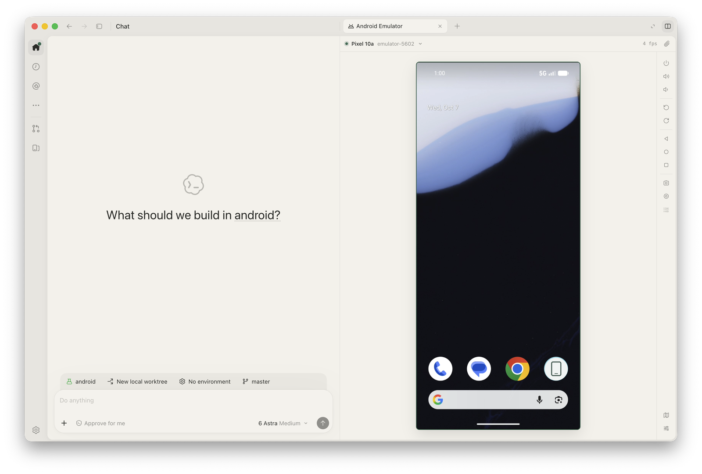
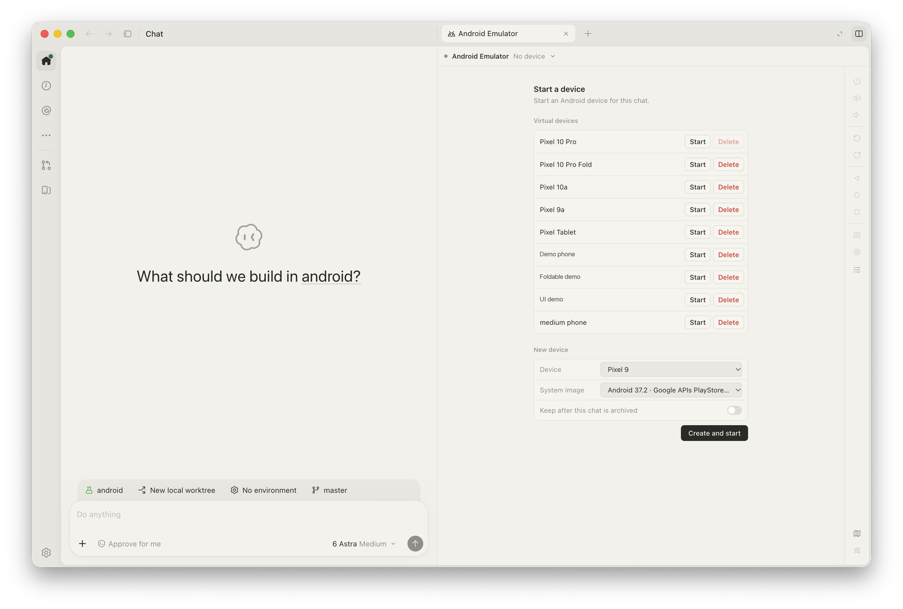
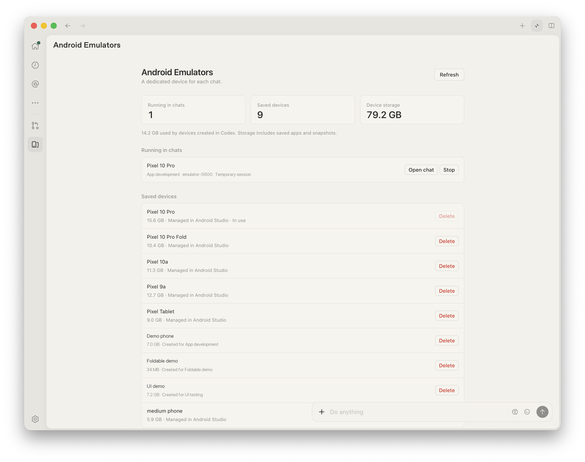

# Android™ Emulator Plugin

[](https://androidweekly.net/issues/issue-749)

Run, control, and test Android apps from Codex. Pin emulators and connected Android devices to a chat, then watch the agent work or take control in the live panel.



<table>
  <tr>
    <th>Start or create a device</th>
    <th>Manage devices across chats</th>
  </tr>
  <tr>
    <td><a href="assets/screenshots/device-setup.png"></a></td>
    <td><a href="assets/screenshots/device-manager.png"></a></td>
  </tr>
</table>

<sub>Screenshots use example chat names, device names, and app icons.</sub>

## Features

- **Exclusive devices per chat:** pin multiple emulators or connected Android devices for before/after testing. Each device belongs to one chat; moving a connected device to another chat requires confirmation.
- **Compare devices:** switch between device tabs or drag one tab onto another to view both side by side. Hidden tabs pause their streams.
- **Live controls:** tap, swipe, type, rotate, adjust volume, and change foldable posture.
- **Agent tools:** inspect screenshots and UI elements, target controls by name, enter text, and wait for screen changes.
- **App testing:** install APKs, open apps and links, manage permissions, and change device conditions such as dark mode, font size, location, and battery level.
- **Debugging and capture:** read Logcat, diagnose connection problems, capture screenshots, record video, and copy captures to the clipboard or add them to chat.
- **Optional screen memory:** enable Minimap tracking to remember screens and routes as the agent uses an app. Return to a saved destination from the Screen map panel, or turn tracking off to use ordinary device controls without Minimap.
- **Saved screen graph:** inspect screens and directed routes in the Screen map's Graph view, with a complete route list and matrix. Graph export requires a separately configured graph-capable Minimap build; see the requirements below.

The **Android Emulators** sidebar manages running devices and saved virtual devices. Multiple views of a device share its video encoder; hidden panels pause streaming while the emulator remains available to the agent.

## Requirements

- Codex desktop with plugin support.
- Android SDK Platform Tools on macOS or Linux. Virtual devices also need Android SDK Emulator and a system image. Android Studio can install these through SDK Manager.
- Node.js 20 or newer. The plugin uses Codex's bundled runtime when available.

Use an existing Android Virtual Device or ask the agent to create one. Set `ANDROID_HOME` if your SDK is installed in a custom location. When Minimap tracking is enabled, screen memory prepares its dependencies on first use and needs internet access for missing downloads.

For a physical device, enable USB debugging, connect it, and accept Android's debugging prompt. Select it from the panel's device dropdown. Unpinning releases the connection without shutting down the phone. Rotation, simulated location/battery, fold posture, and snapshots require an emulator.

Screen memory may download Minimap and [Google's Android CLI](https://developer.android.com/tools/agents/android-cli/download) directly from their upstream servers. The CLI launcher can download its own runtime and is invoked even during version checks. Review the applicable [Android SDK terms](https://developer.android.com/studio/terms) before first use; users handle their own agreement. To use installations you manage yourself, set `ANDROID_EMULATOR_MINIMAP` and `ANDROID_EMULATOR_ANDROID_CLI` to those executables. These tools are downloaded separately and are not included in the plugin archive.

The graph viewer requires a Minimap 0.2.x build that provides `minimap graph`. Set `ANDROID_EMULATOR_MINIMAP` to that executable before starting Codex. The managed Minimap 0.2.1 download supports existing navigation but cannot export a graph; use the **Navigate** tab with that version. Inspecting a graph does not move the device, observe its screen, or install dependencies. Select a screen to inspect its saved metadata, then use **Go** explicitly to replay a route. Existing maps need no migration.

## Install

```sh
codex plugin marketplace add mttmcknn/android-emulator-plugin
codex plugin add android-emulator-plugin@mttmcknn
```

Restart Codex, then ask:

> Start an Android emulator for this chat.

You can also ask the agent to install an APK, test a screen, inspect Logcat, or diagnose a connection problem. Drag an APK onto the device panel to install it directly.

To update an existing marketplace installation:

```sh
codex plugin marketplace upgrade mttmcknn
codex plugin add android-emulator-plugin@mttmcknn
```

Restart Codex to load the updated tools and panel resources. The repository marketplace installs the generated plugin directory from `main`; versioned ZIPs, checksums and source provenance are also available in [GitHub releases](https://github.com/mttmcknn/android-emulator-plugin/releases).

## Captures and screen memory

**Enable Minimap tracking** is on by default. Change it in the plugin's settings
under **Screen map**, or open the device panel's **Device controls** and use the
same switch. The setting applies to all chats and pinned devices and survives
restarts.

When off, the plugin does not launch, probe, download, track, navigate or export
graphs with Minimap. Ordinary emulator tools remain available, and UI inspection
uses the existing ADB reader. The Screen map drawer shows that tracking is off.
Turning it off cancels and waits for plugin-owned Minimap work; completed device
actions are not undone or repeated. Saved maps and app associations are kept.
Re-enable tracking to resume using them. The graph-capable CLI requirement above
still applies, and unsupported graph export is reported explicitly.

The camera and recording controls open a capture tray with **Copy**, **Add to chat**, and **Copy + add to chat** actions. The paperclip adds a screenshot to chat in one step.

Screenshots enter chat as images. Recordings add a local video reference and up to four timestamped frames. Clipboard export requires macOS; video sample frames require `ffmpeg` and `ffprobe`.

Captures and new screen maps stay in the plugin's local state directory. Maps are separated by project and app; an existing matching `.minimap/` map is reused. Supported agent taps, swipes, and Back actions teach routes. Text entry, long presses, custom gestures, and manual panel input remain direct controls. The agent checks the current screen before using a learned route.

## Development

```sh
npm run build
npm test
codex plugin marketplace add "$PWD"
codex plugin add android-emulator-plugin@mttmcknn
```

The shared service and UI live in `runtime/core`, MCP support in `runtime/mcp`, and the Codex integration in `runtime/hosts/codex`. Edit source under `runtime/`, then rebuild the generated plugin bundle. Root `LICENSE` and `NOTICE` are authoritative; the build copies them into the runtime and installable plugin so retained helpers keep their notices. Capture, device control, streaming, recording, and navigation implementations can be selected per chat.

For a repeatable release ZIP from a clean committed checkout, run `npm run package:submission`. It builds, runs local tests, checks the actual archive and writes the ZIP, checksum, release notes and readiness report to `dist/`. Maintain a matching version entry in [CHANGELOG.md](CHANGELOG.md); packaging rejects missing or empty entries and generates the release notes from that section. [Submission preparation](SUBMISSION.md) explains the author copy and remaining registry requirements. The [release workflow](GITHUB-RELEASES.md) documents local publication and an optional manual GitHub workflow that defaults to artifacts and can attach them to an explicitly requested draft release; pushes do not trigger it.

## License and attribution

Apache-2.0. See [LICENSE](LICENSE).

The bundled, unmodified **scrcpy Android server 5.0.1** is licensed under Apache-2.0. Its [source information and binary component inventory](runtime/core/vendor/SCRCPY-SOURCE.md), [license](runtime/core/vendor/SCRCPY-LICENSE), and component notices are included. The plugin uses its own client and browser decoder; desktop scrcpy, FFmpeg, SDL and ADB are not bundled.

The Logcat icon uses [Lucide's Logs icon](https://lucide.dev/icons/logs) under the [ISC license](runtime/core/vendor/LUCIDE-LICENSE).

Android is a trademark of Google LLC. The Android robot is reproduced or modified from work created and shared by Google and used according to terms described in the [Creative Commons 3.0 Attribution License](https://creativecommons.org/licenses/by/3.0/). Modifications include redrawing, scaling, color and combining with a phone. This plugin is not made or endorsed by Google or OpenAI.

See [NOTICE](NOTICE) for distributed attribution and [LICENSE-AUDIT.md](LICENSE-AUDIT.md) for the release inventory, external tools, managed downloads, authoritative sources and unresolved publication risks. The audit is evidence for this artifact, not a legal guarantee.
